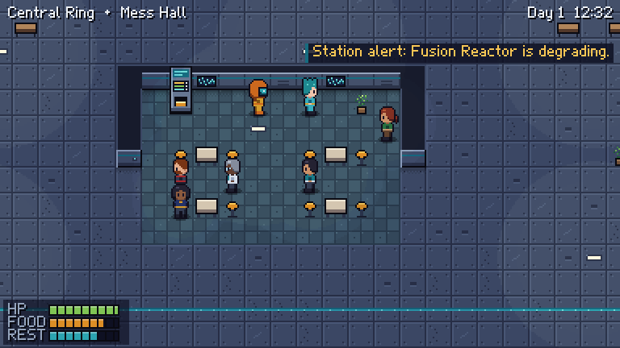
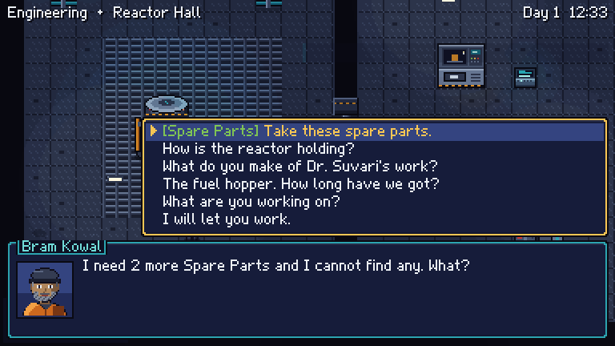
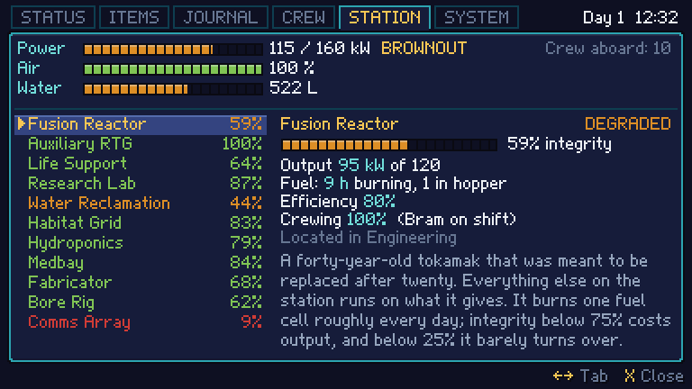
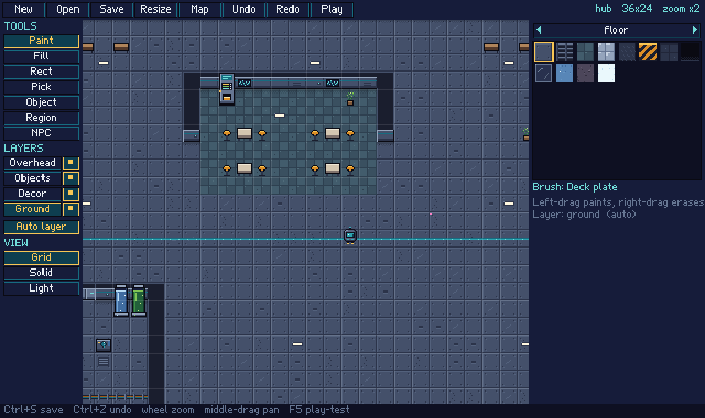
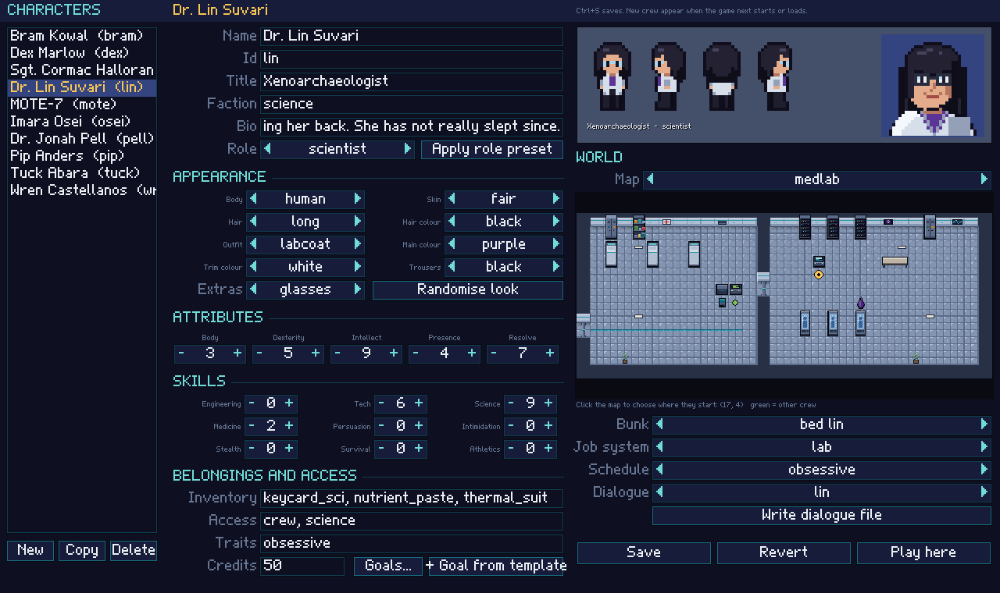

# Tethys Deep

A branching, story-driven sci-fi RPG written in Python, with a 16-bit look -
and the small framework it is built on: maps you walk between, characters you
talk to, stats, items, saving and loading, a map editor, a character creator,
and a station simulation that keeps running whether you are watching or not.



You are an auditor sent to Ithaca Station on Saturn's moon Tethys: ten people,
one tired reactor and a drill that has been biting into the ice for forty
years. The tug that dropped you returns in five days. What your report says,
and whether there is still a station to report on, is up to you.

## Quick start

```
pip install -r requirements.txt
python main.py
```

That is the whole installation. The only dependency is
[pygame-ce](https://pyga.me) (classic `pygame` 2.x works too). There are no
image, font or sound files to download: every tile, sprite, portrait, icon,
letter and sound effect is drawn or synthesised by the code in `game/art` and
`game/engine`.

Tested on Python 3.11, 3.12 and 3.13.

| | |
|---|---|
| `python main.py` | play |
| `python main.py --scale 4` | bigger window (1 to 8; the game renders at 384x216) |
| `python main.py --load autosave` | continue from a save slot |
| `python main.py --no-audio` | no sound |
| `python map_editor.py` | the map editor |
| `python character_creator.py` | the character creator |

## Playing

| Action | Keys |
|---|---|
| Move | arrow keys or WASD (hold Shift to run) |
| Talk, use, confirm, next page | E, Space, Enter or Z |
| Back, cancel | X, Backspace or Esc |
| Datapad (status, items, journal, crew, station, system) | Tab or Esc |
| Switch datapad tab | Q and R (or PgUp / PgDn) |
| Straight to a tab | I items, J journal, C crew, M station |
| Wait an hour or more | T |
| Quick save / quick load | F5 / F9 |
| Fullscreen, screenshot | F11, F12 |
| Debug overlay | F3 (then F6 / F7 skip one / six hours) |

The game autosaves whenever you change area; the System tab of the datapad
has six manual save slots and the options.

A few things worth knowing:

* **One real second is one game minute.** The tug docks on Day 6 at 08:00.
  Give your verdict at the main airlock in the Hangar Bay.
* **You get hungry and tired** like everybody else. Eat from your pack (Items
  tab) or the galley dispenser in the mess hall; sleep in your bunk in the
  Habitat Ring.
* **Dialogue choices show what they need.** `[Engineering 5]` needs that skill
  level, `[Persuasion 55%]` is a dice roll with those odds, `[Spare Parts]`
  hands something over, `[70 cr]` costs credits. Which options you see depends
  on your background, your skills, what you have found out and how much the
  person likes you.
* **System consoles** (reactor, life support, hydroponics ...) let you fit
  spare parts, jury-rig a failing machine, switch it off, or move it up and
  down the power queue. You need the Administrator's authority or some Tech
  skill.
* **The Crew tab** shows where everyone you have met is, what they are doing
  this minute, what they are trying to achieve and what they are short of.
* There is no combat. Problems are solved by talking, fixing, trading,
  sneaking and deciding.



## The station runs without you

Ithaca's systems depend on each other. The reactor feeds a power queue; life
support, the water plant, hydroponics, the fabricator and the lab take from it
in priority order; hydroponics turns water and power into food and air; hungry
or breathless people work worse; and the machines need those people to keep
them running.



Every crew member lives in that same simulation. They follow a daily
schedule, and they set goals for themselves when something is wrong: fetch
food when hungry, sleep when exhausted, find a spare part and repair the
machine they are responsible for, refuel the reactor. Some have private plans
that unfold over days. All of it happens at the same fidelity on every map,
whether you are in the room, on another deck, asleep or waiting - the
engineer really walks to the stores, really takes the last spare part, and it
is really gone when you look for it.

Watch it happen with no player at all:

```
python -m game.tools.simulate --days 6 --every 12 --log --crew
```

Left alone, the station fails in about four days. Each thing you fix (or
break) moves that story somewhere else.

## Tools

### Map editor

```
python map_editor.py            # open the first map
python map_editor.py hub        # open data/maps/hub.json
python map_editor.py --new cargo_bay 30 20
```



Paint tiles and multi-tile props on four layers (walls and windows join up
automatically), flood-fill and rectangle tools, place and edit objects (doors,
portals between maps, containers, consoles, beds, lights, triggers, scripted
interactions), draw named regions, and drop characters where they should start.
Undo/redo, collision and lighting previews, and **F5** saves and starts the
game on the tile under the cursor. Saving runs the content checker and reports
anything broken (a portal into a wall, an unknown item in a locker).

### Character creator

```
python character_creator.py                              # the window
python character_creator.py --new "Kira Vance" --role engineer
python character_creator.py --new "Bolt" --role drone --map hub --pos 20,12
python character_creator.py --roles                      # list the role presets
```



One command (or the **New** button) produces a complete crew member from a
role preset: stats, a look that suits the job, a free bunk, a workplace, a
daily schedule and a sensible place to stand. Save, and the next game you
start - or the next save you load - has them walking the corridors, doing
their job, eating, sleeping and answering questions about what they are up to.
Everything can be adjusted in the window, with a live sprite and portrait
preview and a click-to-place map.

### Command-line helpers

| Command | What it does |
|---|---|
| `python -m game.tools.validate` | check every content file: dangling dialogue links, unknown items, bad scripts, unreachable maps ... |
| `python -m game.tools.validate --api` | list every script function |
| `python -m game.tools.simulate --days 5 --log` | run the station headless and print what happens |
| `python -m game.tools.mapshot` | render every map to `map_shots/*.png` |
| `python -m game.tools.artdump` | contact sheets of all tiles, props, sprites and icons in `art_dump/` |
| `python -m game.tools.seed_maps` | rebuild the shipped maps from their source layouts (`--force` overwrites edits) |

## Making your own story

The engine knows nothing about Tethys. Everything specific to this game is
data in `data/`: JSON files for maps, characters, dialogue trees, quests,
items, station systems, schedules, goal templates, story rules and endings.
Conditions and effects inside those files are written in a small, safe
scripting language (`"if": "skill('tech') >= 4 and not flag('lab_hacked')"`).

* **[docs/AUTHORING.md](docs/AUTHORING.md)** - how each kind of content file
  works, with examples, and how to extend the engine itself.
* **[docs/SCRIPT_API.md](docs/SCRIPT_API.md)** - every script function.

Point the game at a different content folder with `--data path/to/data` (or
the `GAME_DATA_DIR` environment variable) to keep several stories side by
side.

## Project layout

```
main.py  map_editor.py  character_creator.py    launchers
data/                    the campaign: maps, characters, dialogue, quests, items, systems ...
game/
  config.py              screen size, tile size, speeds, paths
  content.py             loads data/ into one Content object
  save.py                save slots
  engine/                window and scene stack, input, bitmap font, UI widgets, palette, audio
  art/                   procedural 16-bit tiles, props, character sprites, portraits, icons
  world/                 maps, characters and stats, items, clock, movement, pathfinding, World
  sim/                   station systems, needs and status effects, NPC goal AI, event bus
  story/                 script language and its functions, dialogue, quests, story director
  scenes/                title, play, dialogue, datapad, consoles, trading, saving, endings
  tools/                 map editor, character creator, validator, simulator, test bot
tests/                   pytest suite (runs headless)
saves/                   save files and options (created as you play)
```

`game/world`, `game/sim` and `game/story` never import pygame: the whole game
can be simulated, saved, loaded and tested without opening a window.

## Tests

```
pip install -r requirements-dev.txt
python -m pytest
```

The suite covers the script language, art generation, maps and movement, the
station systems, the NPC AI, every dialogue file (including a random walk
through each conversation), scripted playthroughs of each story branch and
ending, lossless saving, the scenes driven by synthetic input, both editors,
and random-input soak runs of the game and the tools.
