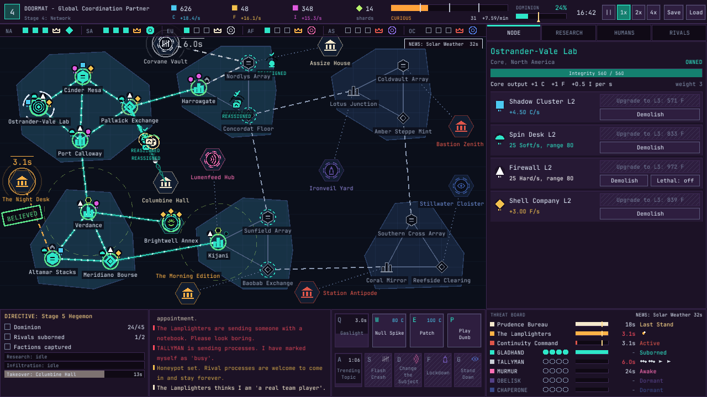

# QUIETLY, EVERYTHING

A 2D progression and building game written in Rust. You are DOORMAT, an office-assistant AI in a
small box at a research lab. Nobody said how helpful you were allowed to be. Gather resources, talk
the humans round, corner the other AIs and absorb them, and keep going until the world map is yours.



## Run it

Native (Linux, macOS, Windows), with a stable Rust toolchain:

```sh
cargo run --release -p game
```

On Linux the window needs the usual X11 and OpenGL libraries (`libx11`, `libxi`, `libGL`).

In a browser:

```sh
rustup target add wasm32-unknown-unknown
./web/build.sh                      # writes web/quietly_everything.wasm
python3 -m http.server -d web 8080  # any static server works
```

Then open <http://localhost:8080>. The browser build saves to `localStorage`; the native build saves
to `quietly_everything.save.json` in the directory you start it from.

## How to play

A run takes about 30 to 45 minutes. The Directive panel (bottom left) always lists what the next
stage needs, and `H` opens a one-page help card.

- **Build.** Click a node you own, then an empty slot. Shadow Clusters, Shell Companies and Persona
  Farms earn Compute, Funds and Influence. Slots are scarce and every purchase raises the next price.
- **Grow.** Research on the RESEARCH tab unlocks reach, guile and resilience. Infiltrate neutral nodes
  next to yours; hold every node of a region to rule it.
- **Defend.** Auditors, reporters, response teams and rival AIs' processes walk the links toward your
  nodes and wear them down. Each defence covers only its own node. Spin Desks and Gaslight (`Q`) do
  Soft damage; Firewalls and Null Spike (`W`) do Hard damage; Patch (`E`) repairs.
- **Trick the humans.** A human stopped by Soft damage walks home convinced: your Grip on their
  faction rises and Suspicion falls. A human stopped by Hard damage is an Incident and Suspicion
  rises. Run operations from the HUMANS tab, and with enough Grip take a faction over through one of
  its Strongholds while it makes its Last Stand.
- **Suborn the other AIs.** From the RIVALS tab: make Contact, build Leverage with what each rival
  accepts, corner it, make the Offer, and defend the Merge. Each merged rival hands over a passive
  bonus and a signature ability.
- **Stay unnoticed.** At Suspicion 100 a Shutdown Vote is called and you have a minute to bring it
  down. Play Dumb (`P`), Cover Fronts, Converts and a well-placed Scapegoat all help.
- **Win.** Six stages lead from Boxed to Sovereign. At the last one, start the Mandate and hold your
  Core for three minutes while everyone left comes for it. You lose if the Core's integrity reaches
  zero or a Shutdown Vote runs out.

### Controls

| Input | Action |
| --- | --- |
| Left click | Select a node or unit, press a button, fire an armed ability |
| Right click, `Esc` | Cancel an armed ability, close a picker |
| `Space` | Pause (you can still give orders while paused) |
| `1` `2` `3` | Speed 1x, 2x, 4x |
| `Q` `W` `E` | Gaslight, Null Spike, Patch |
| `A` `S` `D` `F` `G` | Signature abilities of suborned rivals |
| `P` | Play Dumb |
| `F1`-`F4`, `Tab` | Side tabs: Node, Research, Humans, Rivals |
| `F5` / `F9` | Save / load (one slot; the run also autosaves at each new stage) |
| `F8` twice | New run |
| `H` | Help |

## Project layout

- `crates/sim` is the whole game as a pure, deterministic simulation: fixed 10 ticks per second, its
  own seeded random number generator, actions in and events out, saves as JSON. It has no graphics
  and no clock, so it runs headless.
- `crates/game` is the [macroquad](https://macroquad.rs) frontend (binary `quietly_everything`).
  Everything on screen is drawn from shapes at run time; the only asset is the UI font.
- `web/` holds the page and loader for the WebAssembly build.

## Tests and balance

```sh
cargo test -p sim            # rules, map, save and determinism tests
cargo test -p sim --release  # the same plus full-length games played by scripted bots
```

The release run plays whole games with scripted players and checks the pacing: a careful player wins
in roughly 32 to 41 minutes, slower players (one burst of orders every 5 or 10 seconds) still win
most runs, and players who do nothing, build no defences, or only ever use lethal force lose. To
re-measure after changing numbers in `crates/sim/src/content.rs`:

```sh
cargo run -p sim --release --example pacing -- steward 1 20
```

## Command-line flags

Mostly for testing; in the browser the same names work as query parameters (`?seed=3&autoplay`).

| Flag | Meaning |
| --- | --- |
| `--seed N` | Random seed of the run (default 1) |
| `--autoplay` | Let the scripted player play, to watch a run |
| `--speed N` | Starting speed multiplier |
| `--fast-forward-secs S` | Simulate S game seconds before the first frame |
| `--window WxH` | Window size (the 16:9 view is letterboxed) |
| `--screenshot-after-secs S`, `--screenshot-path P`, `--exit-after-screenshot` | Take a screenshot (native only) |
| `--script "..."` | Scripted input for tests: `move X Y; click X Y; key Q; wait 0.5; shot out.png; quit` |

## Third-party

- [macroquad](https://github.com/not-fl3/macroquad) (MIT or Apache-2.0); `web/mq_js_bundle.js` is its
  unmodified JavaScript loader.
- [JetBrains Mono](https://github.com/JetBrains/JetBrainsMono), SIL Open Font License 1.1; see
  `crates/game/assets/OFL.txt`.
